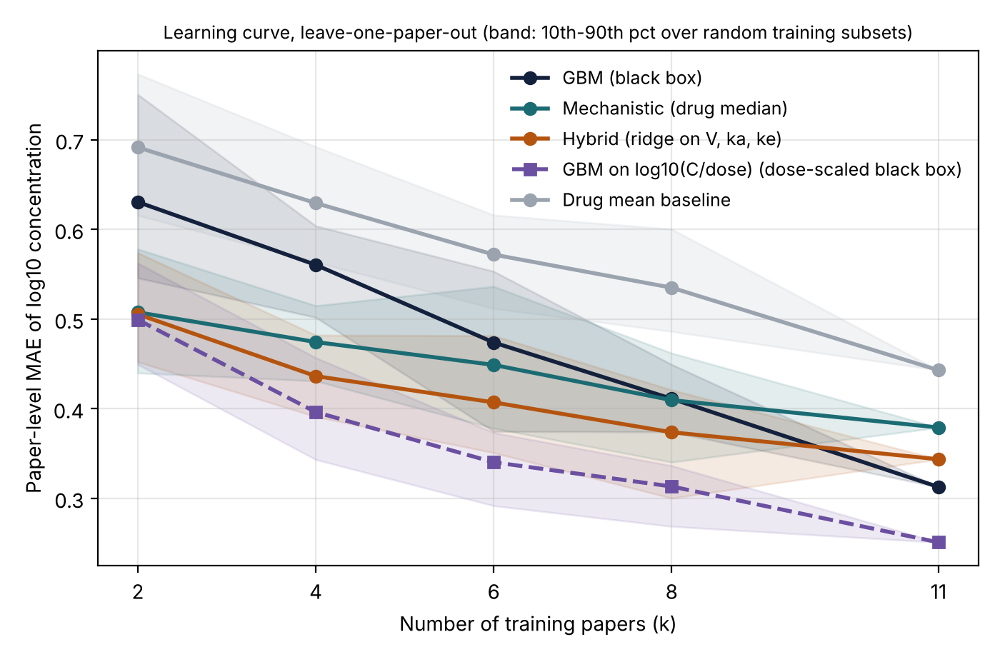

# Hybrid mechanistic PK models on PEAK-extracted curves

Does a mechanistic prior help predict pharmacokinetic (PK) concentration–time curves extracted from the literature, compared with a black-box regressor, when the dataset is small?

This is a feasibility study on curves extracted by **PEAK** (formerly AutoPK; automated PK extraction from manuscript figures). Negative results are reported as they are.

## Summary

| Question | Result |
|---|---|
| Is the data usable? | 204 curves in the index → 193 checked against source papers (21 papers) → 57 kept (16 papers) → 47 oral (14 papers) → 44 human oral (12 papers) → **42 curves / 12 papers** evaluated (≥4 points after cleaning) |
| Does structure help on unseen papers? | All structured models beat the mean baseline (MAE 0.66) by a wide margin. Hybrid (0.34) and GBM (0.31) are **not distinguishable**: hybrid − GBM = +0.03, 95% bootstrap interval [−0.04, +0.10] |
| Unseen doses? | Mechanistic models beat the plain GBM in one dose-ranging study (0.09 / 0.11 vs 0.22), **but a GBM that predicts log10(C/dose) matches them (0.10)**: the advantage comes from dose proportionality, not from curve shape. One study, four curves |
| Is the prior more valuable with less data? | Versus a plain GBM, yes: hybrid is better with 2 and 4 training papers (−0.13, −0.12 MAE, intervals exclude 0) and the gap closes by ~8 papers. But the dose-scaled GBM is as good as or better than every other model at every training size (learning curve below) |
| Unseen populations? | No benefit from structure (pregnancy, renal impairment, DDI). Hybrid fails on DDI because ridge regression learned a spurious covariate effect from 3 curves of one study |

## Data

- `data/curves_long.csv`: points digitized by PEAK (one row per point).
- `data/curve_metadata.csv`: per-curve metadata curated **by hand** by reading the source papers (route, regimen, tau, observed vs simulated, mean vs median, `use_for_training`, confidence, evidence, page). 193 curves from 21 papers; the remaining 5 of the 26 papers in the index are not yet checked.

Main curation finding: many extracted curves are **not observations** (PBPK/popPK simulations, confidence bands, replotted historical controls, animal or tissue curves). A first run that included simulations was retracted.

## Models

All models predict log10 concentration at each time point of an unseen curve.

1. **Mean baseline** (global, and per analyte).
2. **GBM**: gradient boosting, 200 trees, depth 3, learning rate 0.05, subsample 0.8. Features: t, log10 dose, tau, dosing-kind code, pregnancy/renal/DDI flags, analyte one-hot.
3. **mech_pop**: one-compartment oral (Bateman) model, C(t) = (D/V)·ka/(ka−ke)·(e^(−ke·t) − e^(−ka·t)), with V, ka, ke set to the training median for the analyte. Single, multiple, steady-state and prior dosing handled by superposition.
4. **Hybrid**: same formula; log V, log ka, log ke predicted per curve by Ridge regression (alpha = 3) on standardized log10 dose, covariate flags and analyte one-hot.

Per-curve parameters are obtained by least squares on log10 concentration (multistart, ka > ke enforced).

## Evaluation

- Metric: mean absolute error (MAE) of log10 concentration (0.1 ≈ 1.26-fold, 0.3 ≈ 2-fold).
- **Leave-one-paper-out** (curves from one paper share population, assay and digitization, so splitting by curve would leak).
- **Bootstrap over papers** (2,000 resamples, 95% interval); the effective sample size is the number of papers (12), not curves.
- Extrapolation: leave-one-dose-out in one dose-ranging study (PMID 11557462); leave-one-population-out (pregnancy, renal impairment, DDI).

## Results (paper-level MAE, 42 curves, 12 papers)

| Model | MAE |
|---|---|
| Mean baseline | 0.66 |
| Analyte mean | 0.44 |
| GBM | 0.31 |
| mech_pop | 0.38 |
| Hybrid | 0.34 |

Hybrid is better than GBM in only 4 of 12 papers. Full outputs: `results/`.

## Follow-up experiments (`src/extras.py`)

**A. Dose-scaled control for the dose-extrapolation test.** The plain GBM cannot know that concentration is proportional to dose, so beating it there is partly by construction. A GBM trained on log10(C/dose) (prediction multiplied back by dose) gets the same dose scaling as the mechanistic model:

| Held-out dose (PMID 11557462) | GBM | GBM on C/dose | Mechanistic | Hybrid |
|---|---|---|---|---|
| 75 mg | 0.37 | 0.12 | 0.11 | 0.11 |
| 150 mg | 0.28 | 0.08 | 0.07 | 0.10 |
| 300 mg | 0.06 | 0.06 | 0.08 | 0.10 |
| 600 mg | 0.18 | 0.14 | 0.11 | 0.13 |
| Mean | 0.22 | 0.10 | 0.09 | 0.11 |

The advantage on unseen doses is therefore explained by dose proportionality; there is no evidence here that the compartment-model *shape* contributes. With all four doses of the study held out the picture is the same (0.25 / 0.11 / 0.11 / 0.12).

**B. Sensitivity to PMID 33252495** (3 curves, 5 points each; the only paper with fewer than 6 points per curve, so the rule "median points per curve < 6" selects it uniquely. The rule was chosen after seeing that this paper dominates the difference, so all versions are reported.)

| LOPO variant | GBM | GBM on C/dose | Mechanistic | Hybrid | Hybrid − GBM (95% CI) |
|---|---|---|---|---|---|
| All 12 papers | 0.31 | 0.25 | 0.38 | 0.34 | +0.03 [−0.04, +0.11] |
| Dropped from test average only (11 papers, still in training) | 0.27 | 0.24 | 0.31 | 0.27 | +0.00 [−0.05, +0.05] |
| Dropped from training and test (11 papers) | 0.33 | 0.26 | 0.30 | 0.25 | −0.08 [−0.15, −0.02], hybrid better in 8/11 |

The paper hurts the hybrid when used as a training label source (noisy fitted parameters from 5 points) but helps the GBM (its points still carry information). Hybrid vs the dose-scaled GBM: +0.09 [+0.01, +0.22] with all papers, −0.01 [−0.04, +0.03] without 33252495.

**C. Learning curve.** Leave-one-paper-out, training on k randomly chosen other papers (k = 2, 4, 6, 8, 11; 10 random subsets per held-out paper for k < 11).



| k | GBM | GBM on C/dose | Mechanistic | Hybrid | Hybrid − GBM (95% CI) |
|---|---|---|---|---|---|
| 2 | 0.63 | 0.50 | 0.51 | 0.51 | −0.13 [−0.27, −0.02] |
| 4 | 0.56 | 0.40 | 0.47 | 0.44 | −0.12 [−0.22, −0.05] |
| 6 | 0.47 | 0.34 | 0.45 | 0.41 | −0.07 [−0.15, +0.01] |
| 8 | 0.41 | 0.31 | 0.41 | 0.37 | −0.04 [−0.10, +0.02] |
| 11 | 0.31 | 0.25 | 0.38 | 0.34 | +0.03 [−0.04, +0.11] |

Hybrid minus the dose-scaled GBM (paper bootstrap): k=2 +0.01 [−0.02, +0.04]; k=4 +0.04 [−0.02, +0.12]; k=6 +0.07 [+0.01, +0.14]; k=8 +0.06 [+0.01, +0.12]; k=11 +0.09 [+0.01, +0.22]. Mechanistic (drug median) minus the dose-scaled GBM is +0.08 to +0.13 for k ≥ 4 with intervals excluding 0. Only k = 2, 4, 6, 8, 11 were run, so the point where the plain GBM overtakes the hybrid is only known to lie between 8 and 11 papers.

**C′. Learning curve without PMID 33252495** (removed from the training pool and the test set; 11 papers, so k = 2, 4, 6, 8, 10; `results/learning_curve_excl33252495.png`, `results/learning_curve_output_excl33252495.txt`). The exclusion rule was chosen after seeing the full-data results.

| k | GBM | GBM on C/dose | Mechanistic | Hybrid | Hybrid − GBM (95% CI) | Hybrid − GBM on C/dose (95% CI) |
|---|---|---|---|---|---|---|
| 2 | 0.55 | 0.48 | 0.48 | 0.46 | −0.09 [−0.16, −0.03] | −0.02 [−0.06, +0.03] |
| 4 | 0.47 | 0.37 | 0.42 | 0.39 | −0.09 [−0.16, −0.02] | +0.02 [−0.04, +0.08] |
| 6 | 0.40 | 0.31 | 0.37 | 0.31 | −0.09 [−0.19, −0.01] | +0.01 [−0.03, +0.05] |
| 8 | 0.40 | 0.29 | 0.35 | 0.30 | −0.09 [−0.19, −0.02] | +0.01 [−0.03, +0.06] |
| 10 | 0.33 | 0.26 | 0.30 | 0.25 | −0.08 [−0.15, −0.02] | −0.01 [−0.05, +0.03] |

Without that paper the hybrid beats the plain GBM at every training size and is statistically tied with the dose-scaled GBM. The full-data conclusion (hybrid worse than the dose-scaled GBM at larger k) depends on one paper whose 5-point curves give unreliable fitted parameters. Both versions should be reported; neither shows that the compartment shape itself helps beyond dose scaling.

The plain GBM catches up as data grow, as the "priors matter more with little data" idea predicts. But the C/dose GBM is best or tied at every k, so what the data support is "dose scaling matters", not "the compartment shape matters". Note that the dose-scaled GBM was added after seeing the first results, as a control.

## Limitations

- 42 curves from 12 papers: wide intervals. Several comparisons were run (several models, three exclusion variants); the intervals are not corrected for multiplicity. Most curves are tenofovir-related; nothing here generalizes beyond that.
- About two-thirds of the usable curves carry caveats (mean vs median unverified, some digitization doubts).
- One compartment cannot represent the biphasic decline of tenofovir.
- The two-step fit (per-curve fit, then regression) discards parameter uncertainty; ridge alpha was not tuned.
- Some curves are flagged for re-digitization (e.g. PMID 25959631, 33318014).

## Reproduce

See `results/INDEX.md` for which script writes which result file.

```bash
pip install -r requirements.txt
./run_all.sh        # writes outputs to results/
```

## Next steps

Verify and re-digitize flagged curves; grow the dataset by screening more papers; replace the two-step fit with a hierarchical (mixed-effects) model; add a `data_origin` field (observed / simulated) to the PEAK index.
